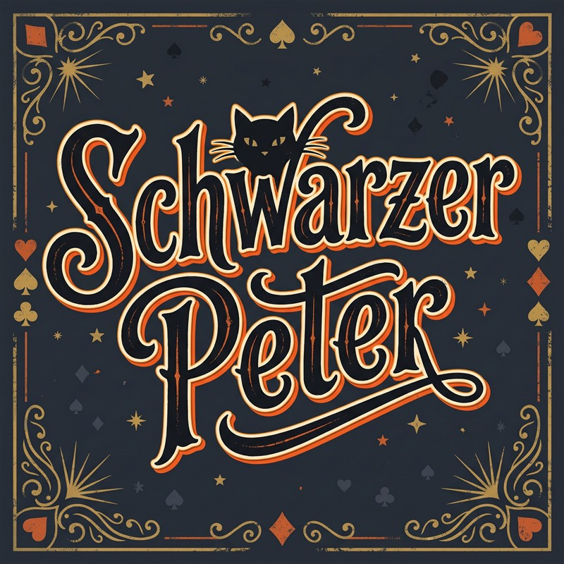
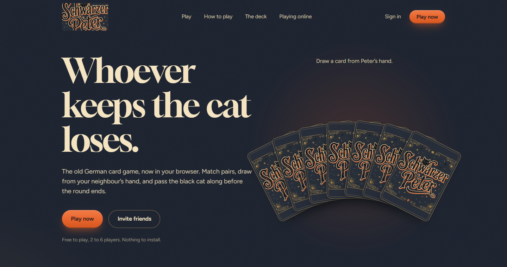
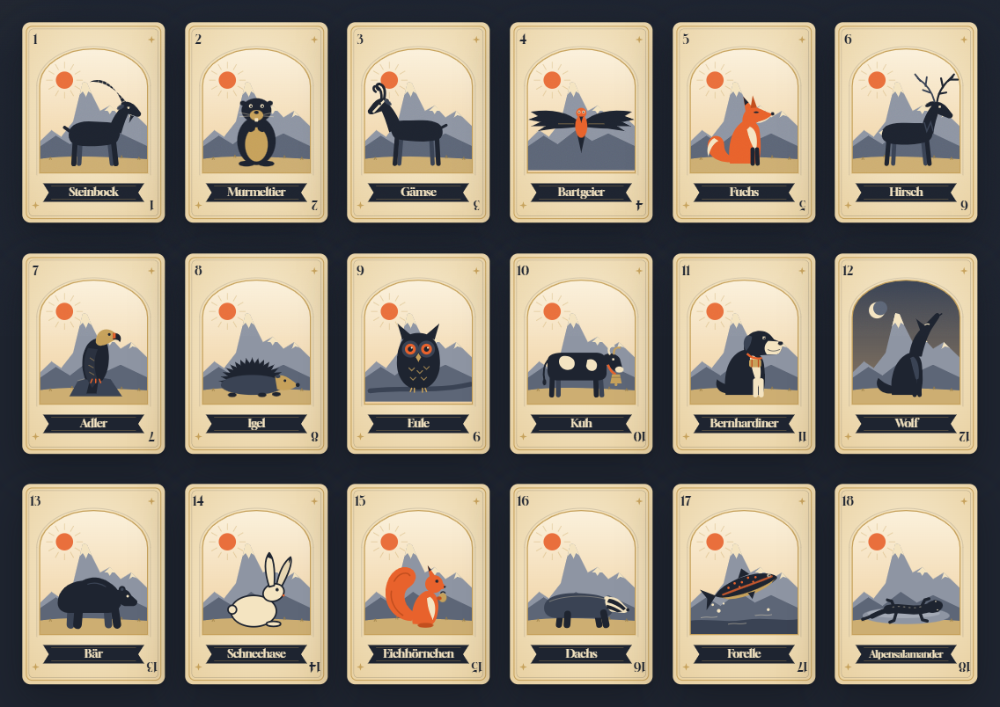

  

<strong>Whoever keeps the cat loses.</strong> 
The classic card game from Germany and Switzerland, now online.

<a href="https://schwarzerpeter.vercel.app"><strong>schwarzerpeter.vercel.app</strong></a>

---

## What is Schwarzer Peter?

Schwarzer Peter ("Black Peter") is a card game that children in Germany, Switzerland and Austria have played for generations. It's simple enough for a five-year-old and still fun for grown-ups, because the whole game comes down to one moment: reaching for a card in someone's hand and hoping it isn't the one.

The deck is made of matching pairs plus one card with no partner: the **Schwarzer Peter**. Keep matching your pairs, pass the Peter on when you can, and don't be the one left holding it at the end. Traditionally, the loser gets a smudge of soot on their face.

  

## How to play

**The goal:** match and lay down as many pairs as you can, and don't be left with the Schwarzer Peter.

**The deck:** 15 to 18 pairs (30 to 36 cards), plus the one Schwarzer Peter.

1. **Deal and sort.** The dealer shuffles and deals out every card. It's normal for some players to get one more than others. Everyone lays their matching pairs face up on the table and keeps the rest hidden.
2. **Draw a card, clockwise.** The player to the dealer's left holds out their cards face down to the next player, who picks one at random. If it makes a pair, the pair goes on the table. If not, the card stays in their hand.
3. **Pass it on.** Whoever just drew now offers their own cards to the next player. Hands get smaller as pairs are laid down. Anyone who gets rid of all their cards is out and safe.
4. **The last one with the cat loses.** Play goes on until only the Schwarzer Peter is left. The player holding it is the only loser.

## The Alpine deck

Our first deck brings the game to the Swiss mountains. It has 18 animals you might meet on a hike, two of each, and one black cat sitting on a rooftop that nobody wants to draw.

  

Steinbock, Murmeltier, Gämse, Bartgeier, Fuchs, Hirsch, Adler, Igel, Eule, Kuh, Bernhardiner, Wolf, Bär, Schneehase, Eichhörnchen, Dachs, Forelle and Alpensalamander. Matching cards share a number in the corner, so pairs are easy to spot even on a phone.

## What's coming

- **Play with friends.** Create a private room and send the link. Everyone joins from their own phone or computer.
- **Bluffing that works online.** Shuffle your hand while someone is choosing, see where their hand hovers, and react with a grin or a gasp.
- **Your language.** Deutsch, Français, Italiano and English.
- **Safe for kids.** No open chat and as little personal data as possible.

## Play

Visit **[schwarzerpeter.vercel.app](https://schwarzerpeter.vercel.app)**. It's free, works in any browser, and there's nothing to install.

You can already **[play a full match against 1 to 5 bots](https://schwarzerpeter.vercel.app/play)**. The bots pick their cards at random, so just like at a real table, it all comes down to luck.

---

Want to look under the hood? See the [developer notes](docs/DEVELOPMENT.md).
